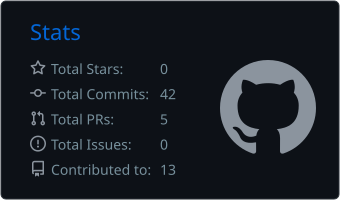
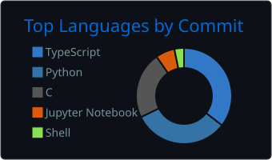

# Hi there! I'm Pedro Calil 👋
### 💻 CS Student · Backend Developer

---

## 🚀 About Me
- 🎓 Computer Science student based in Brazil 🇧🇷
- 🐧 Linux daily driver — comfortable living in the terminal
- 🛠️ Curious about how systems work — from the code down to the machine

---

## 🧰 Tech Stack

### Languages

### Backend

### Databases

### 🛠️ Tools & Version Control

### 📦 Operating Systems

---

## 📊 GitHub Stats
<!-- Cards gerados pela Action em .github/workflows/profile-summary-cards.yml (atualiza 1x/dia). -->

  
  

---

## 🌍 Social Media
- 📫 Email: [pedrocalil.cordeiro@gmail.com](mailto:pedrocalil.cordeiro@gmail.com)
- 💼 LinkedIn: [Pedro Calil](https://www.linkedin.com/in/pcalil/)
